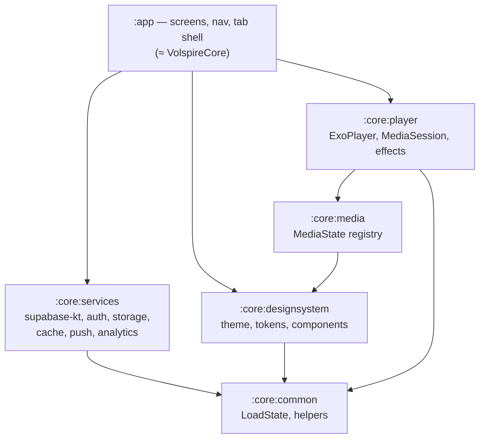

# Volspire Android Port Plan (Kotlin)

**Date:** 2026-07-19 · **Source of truth:** `banana` repo @ `eb0f685` (~43.8k lines Swift, 232 files) · **Goal:** a native Android app with **full feature parity** and the **same look/feel**, sharing the existing Supabase backend unchanged (except a small push-notification addition).

This plan was produced from a full parallel audit of the codebase: every screen file (143/143 accounted for), the complete RPC surface (100 functions), the audio stack, the design system, and the app shell/config.

---

## 1. Executive summary

- **Approach:** native **Kotlin + Jetpack Compose**, single-activity, dark-theme-only, mirroring the iOS module layout (`:core:designsystem`, `:core:services`, `:core:player`, `:core:media`, `:core:common`, `:app`).
- **Backend:** reuse the **same Supabase project** via **supabase-kt 3.6** (BOM). The entire backend surface is 100 Postgres RPCs + 8 storage buckets + 1 edge function — no raw table access, no realtime. Android calls the identical contract.
- **The only backend change required:** add an **FCM sender** to the two push edge functions (`send-activity-notification`, `send-message-notification`), branching on `user_push_tokens.platform`. The token-registration RPCs already take `p_platform`.
- **Audio:** AudioKit → **Media3 1.10 / ExoPlayer**. Every iOS audio workaround (download-to-temp, manual prefetch, dual-player video sync, `engine.stop()` pause hack) disappears — ExoPlayer streams, caches, plays video+audio in one player, and reports state to the system correctly. Speed/preserve-pitch maps 1:1 onto `PlaybackParameters`.
- **Look/feel:** the app barely uses system chrome on iOS (custom tab bar, custom nav bars, custom sheets) — which makes Compose a *better* fit than usual. Geist TTFs and the 90 Lucide SVGs are reused as-is. Real blur exists only on sheets + Now Playing → **Haze 2.0**.
- **Deferred (flag-off on iOS too):** marketplace monetization (`FeatureFlags.marketplace = false`) and the Metal visualizer (`FeatureFlags.visualizer = false` — the only component with no clean Android path).
- **Effort estimate:** ~12–16 engineer-weeks solo at iOS-app scale (~40k lines of Kotlin); heavy AI-assisted development can compress meaningfully. Phases in §11.

---

## 2. Decision record

| Decision | Choice | Why |
|---|---|---|
| Stack | **Native Kotlin + Jetpack Compose** | User asked for Kotlin/Android. KMP would force rewriting the healthy Swift app; Flutter/RN would abandon both native codebases and the design system's platform integration (Media3 session, FCM, photo picker). |
| Compose base | Material 3 scaffolding, **fully custom theme** | iOS already hand-rolls all chrome; M3 gives sheets/ripples/insets while every visible surface uses Volspire tokens. |
| DI | **Hilt** (`@HiltViewModel`) | ~30 view models; manual factories get verbose. iOS's `Dependencies.make()` maps to one Hilt module. |
| State | androidx `ViewModel` + `StateFlow` + `collectAsStateWithLifecycle` | Direct analogue of `@Observable` VMs + Combine; also survives config change/process death, which iOS never had to handle. |
| Repo | **New sibling repo** (suggest `~/Development/volspire-android`) | Different toolchain; keep this plan in `banana` as the parity reference. Same `applicationId com.volspire.app`. |
| minSdk / target | **26 / 36** | supabase-kt requires 26. Real backdrop blur needs 31+ (Haze falls back gracefully below). |
| Orientation | Portrait-locked | iPhone-only portrait app; parity first. |
| Theme | **Single dark theme** | iOS is dark-locked at three levels. Do not build a light theme. |

---

## 3. What we're porting (inventory)

| Module (iOS) | Lines | Contents |
|---|---:|---|
| VolspireCore (app) | 32,499 | 143 files, 20 screen areas, custom tab/nav system |
| Services | 3,890 | Supabase client, 100 RPC wrappers, auth, storage, cache, push, analytics, moderation |
| DesignSystem | 3,544 | Tokens, Geist fonts, 90 Lucide icons, components, modifiers, mesh gradient, dominant colors |
| Visualizer | 1,759 | Metal MilkDrop visualizer — **flag OFF, defer** |
| Player | 1,596 | AudioKit engine, queue, effects, Now Playing/remote commands |
| MediaLibrary | 256 | In-memory `MediaID → Media` registry (RAM only) |
| SharedUtilities | 244 | `LoadState`, debugLog, byte/clamp/lerp helpers, security-scoped file reader |

**Feature surface (5 tabs + 14 routes):** Explore (All/Collab/Workspace/Following/Artists sub-tabs, hero carousel, rails, grids, search overlay) · Library (playlists rail + saved list) · "+" upload hub (Track/Listing/Pack/Service full-screen wizards) · Inbox (DM categories, threads with attachments, collab accept/decline) · Profile (hero, 3 tabs, edit, collab requests) · plus Playlists, MediaCollection ("see all"), Search, Marketplace browse/detail, Listing detail, Workspace folders (members/roles/uploads/comments), Notifications feed, Settings (notification prefs, blocked accounts, legal), Analytics dashboard (charts), full Now Playing (expandable mini-player, comments panel with timestamped comments, effects sheet, add-to-playlist/workspace), moderation everywhere (report/block on 9 target types).

**Currently OFF (port the flag, not the UI):** marketplace monetization, visualizer. **Known iOS gaps that Android must also respect:** account deletion is email-based (required in-app before either store release), repeat is one/wrap-only (no repeat-all), comments are 2-level only.

---

## 4. Architecture mapping



| iOS construct | Android equivalent |
|---|---|
| `@main App` + `AppDelegate` + `Dependencies.make()` | `Application` subclass + Hilt `@Singleton` module (one graph: supabase, auth, mediaState, player, controller, analytics) |
| `@Observable` VM + `@MainActor` | `@HiltViewModel` + `StateFlow`, `viewModelScope` (Main.immediate) |
| Combine publishers → `sink` mirror in `PlayerController` | `StateFlow` collected in a `PlayerController` state holder |
| `actor APICache` | class + `Mutex`; coalescing via `ConcurrentHashMap<String, Deferred<ByteArray>>` |
| `LoadState` (`begin(ifEmpty:)` / `fail(ifEmpty:)`) | same sealed interface, same defensive-empty-state semantics — port verbatim |
| `Environment(Dependencies)` | Hilt constructor injection; `CompositionLocal` only for UI-scoped things (player insets) |
| `NavigationPath` + `Route` enum (14 cases) + `RoutedView` | Navigation-Compose with a `@Serializable` sealed `Route`; destination wrapper logs `page_view` |
| Custom `RootTabView` (kept-alive tabs at opacity 0, timers paused via env key) | Root `Box` holding one NavHost per tab, inactive tabs `alpha 0` + input-disabled; polling gated on `isActiveTab` + `repeatOnLifecycle` |
| Re-tap tab → popToRoot / scroll-reset tick | same: NavController popBackStack to start + a reset counter in state |
| Sheets with detents / self-sized / `.sheetBackground()` | M3 `ModalBottomSheet`: wrap-content = self-sized detent; partial/full expansion ≈ `.medium/.large`; shared background composable = Haze blur + 28% black + drag handle |
| `.fullScreenCover` (upload wizards, cropper) | full-screen nav destinations or dialogs with `UsePlatformDefaultWidth = false` |
| `matchedGeometryEffect` (mini↔full player, composer morph, tab underline) | one always-mounted composable animated by an expansion fraction (as iOS effectively does); Compose `SharedTransitionLayout` where it fits; underline = animated offset |
| `.enableSwipeBack` / hidden system nav bar | predictive back (built-in); custom `CollapsingNavHeader` ports as a plain composable |
| Keyboard observers / `.scrollDismissesKeyboard` | `imePadding()` + `WindowInsets.ime` (simpler than iOS) |
| ScenePhase | `ProcessLifecycleOwner` / `repeatOnLifecycle(STARTED)` |

---

## 5. Backend parity (same Supabase project)

**Client:** supabase-kt **3.6.0** BOM — `auth-kt`, `postgrest-kt`, `storage-kt`, `functions-kt` (no realtime module needed). Base URL `https://api.volspire.com`, same anon key.

### 5.1 RPC contract (the parity backbone — 100 functions)
- All calls are `postgrest.rpc("name", buildJsonObject { ... })` with the exact `p_`-prefixed param names.
- **Explicit JSON nulls matter:** iOS deliberately sends `NSNull()` so PostgREST resolves the right overload (documented `log_analytics_event`/`p_track_id` bug). In Kotlin, send `JsonNull` explicitly — never omit the key.
- **Decoding:** DTOs decode raw RPC JSON — verify against the live DB, not web types. Configure `Json { ignoreUnknownKeys = true; namingStrategy = JsonNamingStrategy.SnakeCase }` (≈ `convertFromSnakeCase`); **timestamps stay `String`** (no date strategy on iOS either — UI parses); wide optionals.
- Full checklist in **Appendix A**.

### 5.2 Storage
Port `StorageService` 1:1: 8 buckets (`post-uploads`, `files`*, `message-attachments`*, `user-avatars`, `user-banners`, `packs`, `application-uploads`, `track-assets`*; * = private → signed URLs, 3600 s expiry). Rules to carry over exactly:
- DB stores **bare paths**; resolve to public/signed URLs at display time (`extractPath` strips the three Supabase URL forms).
- Path templates pin segment 1 to the **lowercased** auth uid (storage RLS). Same `safeStorageExt`/`safeStorageName` sanitizers, same MIME map.
- Avatar/banner are fixed-path upserts → append `?v=<epoch>` cache-buster so Coil doesn't serve stale images.

### 5.3 Auth
| Provider | iOS | Android |
|---|---|---|
| Email/password | Supabase + **6-digit OTP** for verify/recovery | identical via `auth-kt` (`signUpWith(Email)`, `verifyEmailOtp`) |
| Google | native GoogleSignIn SDK → `signInWithIdToken` | **Credential Manager** (Sign in with Google) with the **web client ID** as `serverClientId` → same `signInWith(IDToken)`; register an Android OAuth client (debug+release SHA-1s) in the Google console |
| Apple | native `ASAuthorization` | **must still work** (existing accounts): supabase-kt `signInWith(Apple)` web-OAuth via Custom Tabs; add the Android callback (deep-link intent-filter, e.g. `volspire://auth`) to Supabase's redirect allowlist |

Carry over: `holdSessionForOnboarding` gate (signup → OTP → `create_user` → reveal UI), anti-enumeration handling (empty `identities` ⇒ existing account), **offline-first session restore** (trust local session; don't force network refresh at launch), local-first sign-out ordering (`deactivate_push_token` **before** revoking session, then clear cache). Session persistence: supabase-kt storage backed by **EncryptedSharedPreferences** (replaces Keychain). `currentUserId` lowercased at source; compare user ids case-insensitively.

### 5.4 Push (the one backend work item)
Pipeline today: DB triggers → `activity_log` → edge functions → **APNs**. Android plan:
1. **Edge functions:** add an FCM HTTP-v1 sender (service-account secret) to `send-activity-notification` + `send-message-notification`, branching on `user_push_tokens.platform`. Send **data messages** with the same payload keys (`type`, `convo_id`, `sender_id`, `title`, `object_type`, `object_id`, badge).
2. **Client:** Firebase Messaging; register token via the **same `register_push_token` RPC** with `p_platform: "android"`, `p_device_name: Build.MODEL`; `deactivate_push_token` on sign-out. Runtime `POST_NOTIFICATIONS` permission (13+) requested where iOS calls `enable()` (on auth).
3. **Channels:** `messages` + `activity`, custom sound = `notif.caf` converted to OGG in `res/raw` (channel sound is fixed at creation — pick the final sound before shipping).
4. **Tap routing:** intent extras → the same `routePendingPush` logic (message → conversation; activity → folder/track/listing; fallback notifications list). Badge ≈ `setNumber()` + channel badges (launcher-dependent; iOS-style numeric badge is not guaranteed on Android — acceptable divergence).
5. In-app unread dots stay RPC-driven (`get_unread_counts`) — unchanged.

### 5.5 Analytics
Same two RPCs (`log_analytics_event`, `increment_track_stream`), same 30-event allowlist, same `page_view` = logical screen name in `metadata.to`. The `env` block becomes `{platform: "android", os: "android", os_version, app_version, app_build, device: tablet|mobile}` (smallest-width ≥ 600dp = tablet). Per-launch session UUID + per-listen session ids; port `ListenAnalyticsTracker`'s `track_play → stream_counted → track_ended` funnel off player state.

### 5.6 Caching & polling
- `APICache`: memory-only, TTL tiers 30/60/120/300 s, alphabetically-sorted param keys in cache keys, in-flight coalescing, decoded-value memoization, manual invalidation after mutations, full clear on sign-in/out/block. Port as-is.
- **No realtime anywhere** — DMs poll `get_convo_messages` every 4 s while the thread is open; unread counts refresh on foreground/read. Match parity with lifecycle-aware polling (only while RESUMED + visible). Supabase Realtime is an optional later upgrade, not needed for parity.

---

## 6. Design system port (same look)

### 6.1 Theme tokens (dark-only; exact values from the audit)
- **Backgrounds:** `appBase #0D0D0D` (every page) · `appBar #121212` (all chrome: headers, tab bar) · `appCard` white@4% (glassy cards) · `vSurface #1B1B1B` (surface/skeleton fill).
- **Text:** white · `vText2` white@64% · `vText3` white@42%. **Borders: none by design** (`vBorder` = transparent); dividers = white@6–8% hairlines.
- **Accents:** `brand #5096DC` (dark variant renders) · send gradient `#64B4FF → #2966DB` · `vError #F77070` · `vDestructive #FF5E5E` · `vUnread #EF4444` · `vWarning #F59E0A` · `vOwnerGold #FFD600` · 9-color Spectrum set (dark variants) for rotating tints.
- Tailwind gradient parser (`from-… via-… to-…` strings from the web DB) → port the hex map + parser to Kotlin.
- **Compose shape/spacing tokens:** screenPadding 16 · gridPadding 8 · headerIcon 24 · backIcon 32 · miniPlayer 56 · tabBar 52 · radii 8/9/11/12/16/20 (all "continuous" — Compose `RoundedCornerShape` is visually close) · `IconSize` 12/14/16/20/24/28/40.
- **contentBottomInset** pattern: every scroll screen pads bottom by tabBar + mini-player allowance — port as a CompositionLocal published by the player controller.

### 6.2 Typography
Bundle the same 4 **Geist** TTFs (OFL-licensed) as a Compose `FontFamily`. Recreate the full `appDisplayLarge(38 bold) … appNano(9)` scale as `Typography` tokens plus the semantic aliases (`trackTitle` = 15 semibold, `trackSubtitle` = 13 regular, `sectionLabel` = 12 semibold uppercase +0.6 tracking, button = 17 semibold). Rule: **never** ad-hoc sizes — tokens only (same discipline as iOS).

### 6.3 Icons
Copy the **same 90 Lucide SVGs** from `DesignSystem/Assets.xcassets/Lucide/` → Android vector drawables (batch-convert; naming `lucide_chevron_left`). A `LucideIcon(name, size: IconSize, tint)` composable mirrors the iOS component. (Alternative: the `composables.com` icons-lucide artifact — but vendoring the identical files guarantees glyph parity.) Also port the wordmark SVG.

### 6.4 Blur / materials (narrow surface)
Bars/chrome are **solid** `#121212` — no blur needed. Real blur only on: sheet backgrounds (`.regularMaterial` + 28% black), Now Playing (thick/thin/ultraThin materials on background, pills, strips, scrims), comment composer. Use **Haze 2.0** behind those surfaces (real blur 31+, automatic scrim fallback below). Rule to carry: **materials fade via alpha, never unmount** (unmounting blinks).

### 6.5 Effects & motion
| iOS | Android |
|---|---|
| Shimmer (1.35 s diagonal sweep, white 6% bones) | custom `Modifier.shimmer()` via `drawWithCache` + infinite transition |
| `entranceReveal` (fade+slide, 0.07 s stagger) | `graphicsLayer` + staggered `animateFloatAsState` |
| `MarqueeText` | `Modifier.basicMarquee()` |
| `ElasticSlider` (overscroll stretch scrubber) | custom Compose slider (drag + resistance curve) |
| CardPress (scale 0.97, α 0.92) | `Modifier.pointerInput` press-scale (shared) |
| EqualizerBars / MediaActivityIndicator | infinite transitions — scope to leaf composables keyed on inputs (repeatForever identity rule) |
| Metal mesh gradient (`ColorfulBackground`) | **AGSL `RuntimeShader`** port (API 33+; the shader is small: bias 0.05 / power 2.5 / noise) with animated multi-radial-gradient fallback on 26–32 |
| `DominantColors` (CIELAB ΔE clustering) | pure-math port to Kotlin over `Bitmap` pixels (or androidx-palette as a stopgap; the port keeps identical colors) |

### 6.6 Component library (build once in `:core:designsystem`)
PrimaryButton (white capsule / 52 & 42 heights), AccentPillButton + AccentChip (send gradient), AvatarView (Coil + initial fallback + shimmer), ArtworkView (downsampled, 0.25 s crossfade, radius 8), TrackListRow (50pt art + title/subtitle + playing overlay), SheetHeader, OptionSheetRow, SkeletonRows, EmptyStateView, LoadErrorView + ErrorBanner (`vError` on `#450A0A`@45%), ScreenHeader (large title + reveal search), CollapsingNavHeader, CollapsedTitleBar (scroll fade 40/70), HeaderIconButton (24pt in 42pt target + unread dot), BackButton, FloatingActionButton (56 white circle), RefreshChip, PlaylistCard, ExpandableText, ConfirmDialogs, ReportSheet, UserOptionsSheet, TrackOptionsSheet, ImageCropper (custom pinch-zoom crop), heroTextShadow (3 stacked shadows).

---

## 7. Screen-by-screen port map

Order matches the build phases in §11. "Risk" = where Android needs real design/engineering judgment, not mechanical porting.

| Area | Screens | Android notes / risk |
|---|---|---|
| **Root shell** | RootTabView, OverlaidRootView, AppView, Splash | Custom tab bar composable (labels 10pt, selected white/#8C8C8C); kept-alive tab NavHosts; overlay stack (player, About modal, avatar zoom, publish toast). **Risk: back-stack semantics per tab + predictive back.** |
| **Auth** | Login, Register (5-step wizard), AuthComponents | CTAs inline under fields (never bottom-bar chrome); 6-digit segmented OTP field; legal sheets; Google/Apple buttons. Location autocomplete needs a MapKit substitute (§8). |
| **Now Playing** | ExpandableNowPlaying, Compact/Regular, Controls, Effects sheet, Comments panel + composer, InfoStrip, WorkspaceFolderPicker, backgrounds | **Highest-risk UI.** Mini→full morph as one composable driven by expansion fraction; drag-to-dismiss + horizontal panel swap (artwork↔comments) with axis lock; timestamped comments (tap→seek, pin position/range); AGSL mesh background; effects sheet with haptic ratchet. ExoPlayer simplifications (§9) offset the UI cost. |
| **Home/Explore** | HomeScreen (+Feed/+Tabs/+Loading), CollabListingRow | 5 sub-tabs, hero carousel (5 s auto-advance — pause when tab hidden), rails/grids, filter sheets, search overlay → SearchScreen. Prefetch covers via Coil. |
| **Library / Playlists / MediaList** | Library, Playlists, PlaylistDetail, AddToPlaylistSheet, MediaCollectionScreen | MediaCollection is the reusable cinematic list (mesh hero, play/shuffle, numbered rows) — build once, reuse for Saved + Playlist detail. |
| **Search** | SearchScreen | Sectioned results (tracks/artists/services/packs); themed field. |
| **Profile** | Profile (+10 view files), EditProfile, CollabRequestSheet | Immersive hero + mini-header crossfade; tab swap is a **plain opacity crossfade** (iOS learned this the hard way — movement-based swaps broke hit-testing); avatar zoom overlay; edit with cropper. |
| **Analytics** | AnalyticsScreen, TrackAnalyticsDetail, Cards | Scrubbable 30/7-day chart (Canvas + drag), stat tiles, top tracks. |
| **Inbox / DMs** | Messages, MessageCategory, Conversation (+Thread/+Attachments), rows | Bubbles with grouping/tails/date dividers; optimistic sends; 4 s poll; attachment flow (photo picker + SAF file picker, 25 MB cap, MIME allowlist, EXIF-strip via re-encode); long-press → bottom sheets (copy/report/share/add-to-workspace); track-share rich cards (`request_metadata.track_ids` → `get_tracks_by_ids` — never parse URLs from text); inline clip player (single-active coordinator); collab accept/decline in header; full-screen thread hides tab bar + mini-player. |
| **Notifications** | NotificationsScreen | Grouped feed (Today/Week/Earlier); `activity_log` IS the feed — never filter its rows; unread snapshot on open. |
| **Workspace** | FolderContents, ManageMembers, FolderFormSheet | SAF multi-import with optimistic upload rows + retry; roles (owner/admin/editor/viewer); file comments play through main player (`playWorkspace`). Folders live on the Home tab. |
| **Upload flows** | NewPostView, UploadTrack (3-step), CreateListing, CreatePack, NewService, EditTrack, UploadFormComponents | Photo picker covers → cropper; video via Media3 **Transformer** (replaces `AVAssetExportSession`; audio-extraction step is unnecessary — ExoPlayer plays video directly); genre picker sheet; char limits; marketplace-flag gating hides paid tiers. |
| **Marketplace (browse-only)** | Marketplace, MarketplaceDetail, ListingDetail, TailwindGradient | Card grids + staggered entrance; parallax hero + collapsed title bar; listing detail: clips, respond/save, comments/responses tabs, author admin. Monetization stays OFF. |
| **Settings / Moderation** | Settings, NotificationSettings, BlockedAccounts, InfoScreens, ReportSheet, dialogs | 9 push-pref toggles (optimistic, one `p_<key>` per call); `mailto:` intent; report/block wording matches iOS (Play UGC policy needs this too). |

---

## 8. Platform-gap ledger (no iOS equivalent → chosen Android solution)

| iOS-only construct | Android solution |
|---|---|
| APNs + `UNUserNotificationCenter` | FCM data messages + NotificationChannels + `POST_NOTIFICATIONS` runtime permission; tap routing via intent extras (handled on main thread — same discipline as the iOS crash fix) |
| Keychain session storage | supabase-kt storage on **EncryptedSharedPreferences** |
| Sign in with Apple (native) | Supabase Apple **web OAuth** via Custom Tabs + deep-link callback (required so existing Apple-account users can log in) |
| AirPlay (`AVRoutePickerView`) | **System Output Switcher** (`ACTION_MEDIA_OUTPUT` / Media3 session integration). Cast support = optional later; not parity |
| Lock screen / MPRemoteCommand | **Media3 `MediaSessionService`** + MediaStyle notification (play/pause/next/prev/seek — same command set; artwork cached once per track) |
| Background audio mode | Foreground service `mediaPlayback` + `FOREGROUND_SERVICE_MEDIA_PLAYBACK` permission |
| Sheet detents / `presentationBackground` | M3 `ModalBottomSheet` (wrap-content = self-sized; partial/full) + shared Haze background composable |
| Materials/blur | **Haze 2.0** (31+ real blur; scrim fallback) — only sheets + Now Playing need it |
| `matchedGeometryEffect` | single-composable morphs driven by animated fraction; `SharedTransitionLayout` where applicable |
| Metal mesh gradient | **AGSL RuntimeShader** (33+) + animated gradient fallback |
| Metal/vDSP visualizer | **Defer** (flag-off). If ever needed: GLSL/Vulkan port + NDK FFT (KissFFT) or JTransforms |
| `MKLocalSearchCompleter` (city autocomplete) | **Decision needed:** Google Places Autocomplete (key + billing) vs built-in `Geocoder.getFromLocationName` (free, coarser, no true typeahead). Recommend Geocoder first (field stores a city string), upgrade if UX disappoints |
| PhotosPicker | `PickVisualMedia` photo picker (no permission, same UX) |
| `.fileImporter` + security-scoped files | SAF (`OpenDocument(s)`) + persistable URI grants |
| `AVAssetExportSession` compression / m4a extraction | Media3 **Transformer** for video compression; **drop** audio extraction (ExoPlayer plays video directly) |
| Share sheet / `UIPasteboard` / haptics | `Intent.createChooser` / `ClipboardManager` / `LocalHapticFeedback` + `HapticFeedbackConstants` (ratchet = `CLOCK_TICK` per step) |
| `UIScrollView` pinch-zoom + cropper | custom Compose `detectTransformGestures` viewer + crop composable |
| App badge numbers | `Notification.setNumber` + channel badges — launcher-dependent; accept divergence |
| `notif.caf` custom sound | same audio converted to OGG in `res/raw`, set on channels at creation |
| iOS OTP autofill (`.oneTimeCode`) | `autofillHints` + SMS-less email OTP: manual entry with paste support |

## 9. Free wins on Android (delete these iOS workarounds)

- **Stream, don't download:** ExoPlayer + `CacheDataSource(SimpleCache)` replaces download-to-temp **and** the manual next-track prefetch (use `DefaultLoadControl`/playlist preloading).
- **One player for video:** no muted-AVPlayer/AudioKit sync, no background timebase detach/reattach, no drift correction backlog item.
- **No `engine.stop()` pause hack:** MediaSession `PlaybackState` is explicit; the resume-reload fallback and disarmed completion handlers all disappear.
- **Audio focus & noisy:** `setAudioAttributes(..., handleAudioFocus = true)` + `setHandleAudioBecomingNoisy(true)`. Note: iOS parity is "keep playing on unplug" — enabling noisy-pause is a deliberate improvement; flag it in QA.
- **Keyboard:** `imePadding()` replaces notification-observer plumbing.
- Queue semantics to replicate exactly (they're product decisions, not platform defaults): wrap-around next/prev, back-restarts-after-3s, repeat-one intercepts skips, shuffle pins current track first and restores original order, effects reset on track change unless "carry to next track."

---

## 10. Project scaffold

```
volspire-android/
  settings.gradle.kts        // :app, :core:designsystem, :core:services, :core:player, :core:media, :core:common
  gradle/libs.versions.toml
  app/src/main/kotlin/com/volspire/app/
    ui/{root,home,library,playlists,medialist,search,profile,analytics,
        messages,notifications,nowplaying,workspace,newpost,marketplace,
        settings,auth}          // mirrors VolspireCore/Screens 1:1
```

Version catalog (verify exact patches at setup): Kotlin 2.2.x + Compose BOM current, AGP 8.x, `io.github.jan-tennert.supabase:bom:3.6.0` (`auth-kt`, `postgrest-kt`, `storage-kt`, `functions-kt`) + Ktor OkHttp engine, `androidx.media3:*:1.10.x` (exoplayer, session, transformer, ui), Coil 3 (compose + network-okhttp), Hilt, `androidx.navigation:navigation-compose`, kotlinx-serialization, `dev.chrisbanes.haze:haze:2.x`, Firebase Messaging (google-services), androidx security-crypto, Credential Manager + `googleid`.

Manifest: portrait activity, dark `windowBackground #0D0D0D`, `MediaSessionService` (`foregroundServiceType="mediaPlayback"`), FCM service, `POST_NOTIFICATIONS`, intent-filter for the Supabase OAuth callback scheme. `applicationId com.volspire.app` (Play + Apple ids match; LLC/account plan applies to both stores).

Testing (match the project's lean style): DTO decode tests against captured live-RPC JSON fixtures (the decode contract is the #1 breakage risk), unit tests for APICache/queue semantics; skip UI test scaffolding for now.

---

## 11. Phased roadmap

| Phase | Scope | Exit criteria | Est. |
|---|---|---|---|
| **0. Foundations** | Scaffold, theme/tokens/fonts/icons, core components, LoadState | Token gallery screen matches iOS side-by-side | 1–1.5 wk |
| **1. Services + Auth** | supabase-kt wiring, RPC core (`cachedRpc`/`performRpc`/`executeRpc` equivalents), DTOs, StorageService, APICache, AuthManager, Login/Register/OTP, session restore | Sign in all 3 providers; decode fixtures green | 1.5–2 wk |
| **2. Player** | ExoPlayer engine, queue/shuffle/repeat semantics, effects, MediaSessionService + notification, mini→full Now Playing morph, effects sheet, backgrounds (AGSL), dominant colors | Lock-screen controls correct; side-by-side playback parity incl. speed | 2–3 wk |
| **3. Browse surfaces** | Root shell + tabs, Home/Explore all sub-tabs, Search, Library, Playlists, MediaCollection | Full browse-and-play loop | 2–3 wk |
| **4. Social core** | Profile (+edit, collab request), Analytics, Notifications, Settings, moderation suite (report/block everywhere) | Follow/collab/moderation flows parity | 1.5–2 wk |
| **5. DMs + Workspace + Push** | Inbox/categories/thread (attachments, clips, polls), folders (members/uploads/comments), FCM client **+ edge-function FCM sender**, tap routing, badges | Push arrives + routes on Android; DM parity | 2 wk |
| **6. Creation + Marketplace** | NewPost hub, UploadTrack wizard (Transformer), CreateListing/Pack/Service, EditTrack, Marketplace browse/detail, ListingDetail | Upload→appears-everywhere loop | 1.5–2 wk |
| **7. Parity QA + Play readiness** | Screen-by-screen side-by-side audit vs Appendix checklists; account-deletion RPC + UI (**both platforms need it**); data-safety form, target API, content rating | Checklist signed off; internal testing track build | 1–2 wk |

Suggested first commit after this plan: Phase 0 + the decode-fixture harness (captures real RPC responses via the existing anon key so DTO work is grounded from day one).

## 12. Risks & open questions

1. **Expandable player morph** — the single hardest UI piece (gesture axis-lock, panel swap, matched artwork). Budget real time; everything else is mechanical.
2. **Decode drift** — 100 RPCs decoded permissively on iOS; Kotlin DTOs must be generated from *live* responses, not guessed (fixture harness in Phase 1).
3. **Apple sign-in on Android** — web-flow UX is clunkier than native; test with a real Apple-created account early (account linking must resolve to the same user).
4. **Blur perf on mid-range devices** — Haze on Now Playing over video; profile early, scrims are the escape hatch.
5. **Location autocomplete** — Geocoder vs Places decision (§8).
6. **Push sound/channels** — channel settings are immutable after creation; finalize sound/importance before first public build.
7. **Account deletion** — required by both stores; needs a backend RPC (mirror web) + Settings UI on both apps.
8. **Marketplace future** — if monetization ever turns ON, Play Billing vs Stripe has the same policy wrinkle as App Store IAP (digital goods). Deferred with the flag.
9. **Visualizer** — no clean path (Metal + vDSP); stays deferred unless it becomes a priority.

---

## Appendix A — RPC parity checklist (100)

Group by feature; check off as each is wired + decode-tested on Android.

- **Home/Explore (5):** `get_home_tracks` · `get_following_feed` · `get_home_feed` · `get_explore_artists` · `get_explore_data`
- **Profile/account (7):** `get_user_profile` · `create_user` · `update_user` · `check_username_available` · `get_tracks_credited_to_user` · `get_user_packs` · `update_user_service`
- **Tracks (5):** `create_track_v2` · `update_track` · `delete_track` · `get_track_metadata` · `get_tracks_by_ids`
- **Track interactions (7):** `get_track_interaction_status` · `like_track` · `unlike_track` · `save_track` · `unsave_track` · `get_user_likes` · `get_user_library`
- **Track comments (3):** `get_track_comments` · `post_comment` · `delete_comment`
- **File comments (3):** `get_file_comments` · `add_file_comment` · `delete_file_comment`
- **Analytics (4):** `get_my_track_analytics` · `get_my_engagement_stats` · `increment_track_stream` · `log_analytics_event`
- **DMs (5):** `get_user_conversations` · `get_convo_messages` · `send_message` · `send_message_with_attachment` · `mark_convo_read`
- **Collab (5):** `send_collab_request` · `accept_request` · `reject_request` · `get_collab_status` · `remove_collaborator`
- **Notifications (5):** `get_user_notifications` · `mark_notifications_read` · `get_notification_preferences` · `update_notification_preferences` · `get_unread_counts`
- **Follow (1):** `toggle_user_follow`
- **Folders (11):** `get_user_folders` · `create_folder` · `update_folder` · `delete_folder` · `get_folder_files` · `add_track_to_folder` · `remove_track_from_folder` · `get_folders_for_track` · `upload_file_metadata` · `delete_file` · `get_workspace_activity`
- **Folder members (4):** `get_folder_members` · `add_folder_member` · `remove_folder_member` · `update_folder_member_role`
- **Playlists (8):** `get_user_playlists` · `get_playlist` · `create_playlist` · `update_playlist` · `delete_playlist` · `add_track_to_playlist` · `remove_track_from_playlist` · `get_playlists_for_track`
- **Listings (13):** `get_listings` · `get_user_listings` · `get_listing` · `create_listing` · `update_listing` · `delete_listing` · `respond_to_listing` · `save_listing` · `unsave_listing` · `get_listing_comments` · `post_listing_comment` · `delete_listing_comment` · `get_listing_responses`
- **Packs (3):** `get_pack` · `create_pack` · `update_pack`
- **Services (3):** `get_service_detail` · `create_service` · `update_service`
- **Search (3):** `search_all` · `search_users` · `get_my_collaborators`
- **Moderation (4):** `submit_report` · `block_user` · `unblock_user` · `get_blocked_users`
- **Push (2):** `register_push_token` · `deactivate_push_token`

Plus edge function `pack-zip` (fire-and-forget after `create_pack`).

## Appendix B — Behavior rules to carry over (hard-won on iOS)

1. Defensive empty states: never show "no content" until a response confirms it; loaded-flags flip on response, not fetch start (`LoadState.begin/fail(ifEmpty:)`).
2. Long-press → bottom sheet everywhere; the app never uses context-menu previews or swipe actions.
3. Option sheet → stage follow-up action in `onDismiss`; never sheet-over-sheet.
4. Materials/blur fade via alpha; never unmount mid-transition.
5. Infinite animations scoped to leaf composables keyed on all inputs.
6. Profile tabs swap with plain opacity crossfade (movement-based swaps broke hit-testing on iOS).
7. Compare user ids case-insensitively; lowercase at source.
8. Bare storage paths in DB; resolve at display; `?v=` cache-buster on avatar/banner.
9. `activity_log` is the notifications feed — never filter/skip rows; prefs/throttle mute pushes only.
10. DM rich track shares come from `request_metadata.track_ids`, never parsed from message text.
11. Auth screens keep CTAs inline under fields — no app-chrome bottom bars.
12. Send explicit JSON `null` for absent RPC params (PostgREST overload matching).
13. Files download with forced `Content-Disposition: attachment` (phishing guard) — keep when opening DM files.
14. Notification tap handling stays on the main thread, synchronously.
